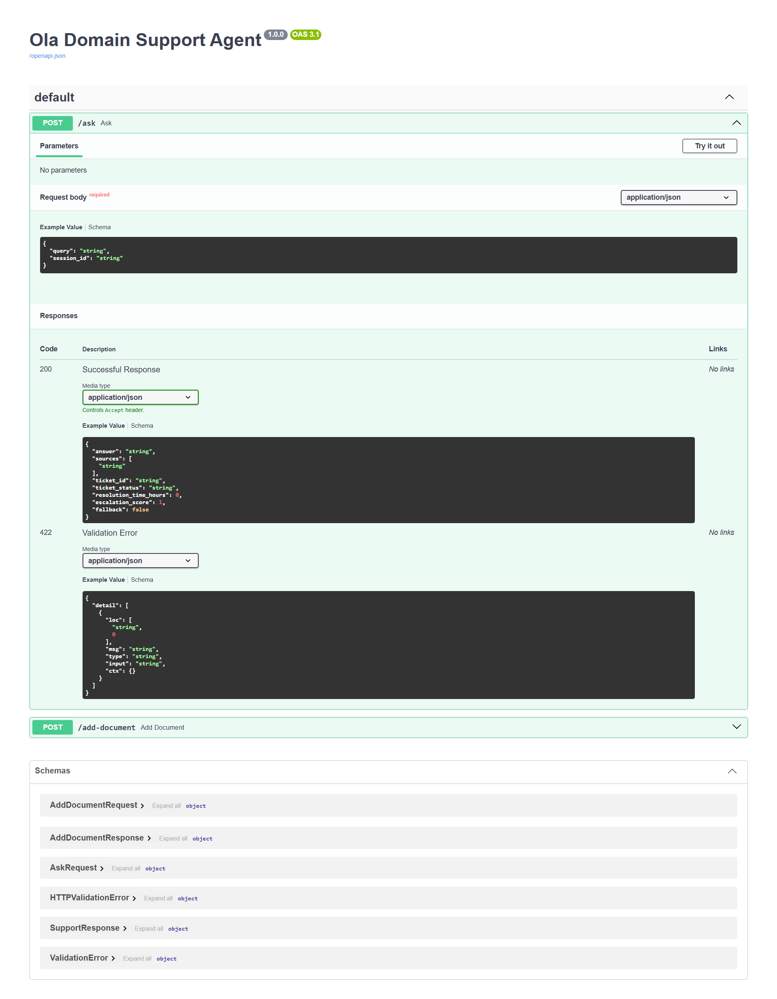

# Ola Domain Support Agent

**Track:** Ola (Business Operations / Customer Support).

**Project status:** Parts 1–2 have initial run evidence. Part 3's FastAPI app starts locally, its OpenAPI page displays `POST /ask` and `POST /add-document`, and a policy question returned HTTP 200 with a structured response. The `/add-document` call, WebSocket disconnect handling, JSONL privacy check, and 15-query evaluation still need recorded evidence. Part 4 remains in progress; retrieval precision and offline embedding execution also need follow-up.

This repository is the 14-day capstone for a deterministic, production-minded support assistant. It combines a generated ticket dataset, a locally embedded policy knowledge base, two retrieval strategies, a CrewAI crew, in-process conversation memory, input and output guardrails, an AutoGen answer review, governance controls, and a FastAPI/WebSocket interface.

The graded path must run with `MOCK_LLM=true`, no API keys, and no outbound LLM calls. CrewAI telemetry is disabled before creating or running the crew. SentenceTransformers may need a one-time model download during setup; cache the model first, then run the demonstrations with network access disabled to verify offline operation.

> **Status note:** Part 1 measurements, Part 2 CrewAI/memory/guardrail demonstrations, and the Part 3 server startup, OpenAPI page, and one successful `/ask` request below reflect supplied run output. That `/ask` answer cited `ticket_priority`, `data_retention`, and `sla_policy`; the latter two are unrelated to the priority question, so retrieval relevance still needs improvement. `/add-document`, WebSocket handling, JSONL privacy, and the 15-query evaluation have not yet been evidenced. Later acceptance demonstrations remain incomplete, so this is not a claim that the full capstone is complete.

## 1. Project layout

Keep source code in `src/ola_support/`, runnable demonstrations in `scripts/`, policy text in `knowledge_base/`, and generated evidence in `reports/` and `transcripts/`.

```text
README.md
requirements.txt
pyproject.toml
.env.example
data/
  generated/support_tickets.json
  reports/dataset_report.json
  reports/escalation_report.json
knowledge_base/                 # 12 original Markdown policies
src/ola_support/
  dataset.py
  schemas.py
  guardrails.py
  rag/
    chunking.py
    embeddings.py
    indexing.py
    retrieval.py
    grounded_generation.py
    evaluation.py
  tools/ticket_lookup.py
  agents/
    mock_crewai_llm.py
    mock_autogen_client.py
    crew.py
    memory.py
    review_team.py
  governance/
    budget.py
    cache.py
  api/
    main.py
    routes.py
    logging_config.py
scripts/
  generate_dataset.py
  build_index.py
  calibrate_threshold.py
  evaluate_retrieval.py
  evaluate_agent.py
  demonstrate_memory.py
  demonstrate_guardrails.py
  demonstrate_governance.py
tests/
transcripts/
reports/
```

The project currently uses a `src/` layout. `pyproject.toml` needs package metadata before `pip install -e .` will work. Until then, set `PYTHONPATH=src` in the shell commands below.

## 2. Dataset design decisions

The current `src/ola_support/dataset.py` declares these reproducibility choices:

| Choice | Value / method |
|---|---|
| Record count | 240 |
| Category values | `Billing`, `Technical Issue`, `Account Access`, `Product Defect`, `General Inquiry` |
| Category weights | Equal; cycling gives 48 records per value, then the list is shuffled using the seeded RNG |
| Status values | `Open`, `In Progress`, `Escalated`, `Resolved`, `Closed` |
| Status weights | Equal; cycling gives 48 records per value, then the list is shuffled using the seeded RNG |
| Dataset seed | `DATA_SEED=2026` |
| Escalation seed | `ESCALATION_SEED=10` |
| Escalation draw | Independent seeded draw with probability `0.20`; the generated percentage must be 10–30% |
| Resolution duration | Uniform draw from 0.5 to 96 hours; intended to represent same-day through multi-day investigation |
| Ticket age | Integer from 0 to 30 days, inclusive |
| Synthetic amount | `amount_inr` is included as an optional field, generated in the ₹50–₹5,000 range to satisfy the submission guideline |

Latest generated report: **47 of 240 tickets were escalated (19.58%)**. Each of the five categories has 48 records, and each of the five statuses has 48 records. This satisfies the Part 1 count and escalation-rate constraints. The generator wrote `data/generated/support_tickets.json` and `data/reports/dataset_report.json`.

The final README and generator must agree exactly about seeds, weights, ranges, and fields. If you change a design choice, update both.

## 3. Environment setup

Use Python 3.11 or another version supported by the exact pinned package versions you select. From PowerShell at the repository root:

```powershell
Set-Location "C:\Users\shour\OneDrive\Desktop\New folder\ola-domain-support-agent"
.\.venv\Scripts\python.exe -m pip install --upgrade pip
.\.venv\Scripts\python.exe -m pip install -r requirements.txt
```

`requirements.txt` currently lists the main packages but does not pin versions. After resolving compatibility, record tested exact versions in a lock file or pin them in `requirements.txt`. Install the project editable only after filling in `pyproject.toml`:

```powershell
.\.venv\Scripts\python.exe -m pip install -e .
```

Set the required environment variables in every new PowerShell session:

```powershell
$env:PYTHONPATH = "src"
$env:MOCK_LLM = "true"
$env:CREWAI_DISABLE_TELEMETRY = "true"
$env:OTEL_SDK_DISABLED = "true"
$env:TOKEN_BUDGET_PER_REQUEST = "2000"
```

The same defaults belong in `.env.example`. Do not put keys or real personal information in the repository. No key should be required by the mock mode.

The latest embedding run printed a Hugging Face Hub unauthenticated-request warning. It did not prevent indexing, but verify local-only runtime after the model is cached. Before the offline verification run, set:

```powershell
$env:HF_HUB_OFFLINE = "1"
$env:TRANSFORMERS_OFFLINE = "1"
```

Do not claim offline embedding execution until indexing and retrieval succeed with these settings enabled.

## 4. Build and run in dependency order

Complete each step before starting the next one. A later layer depends on the outputs of the earlier layers.

### Step 1 — Generate and validate tickets

Implement `generate_dataset()` and `validate_dataset()` in `src/ola_support/dataset.py`. Every record must include `record_id`, `category`, `status`, `resolution_time_hours`, `days_since_created`, and `escalated`; include the planned optional `amount_inr` field if you retain that design choice. The validation function must enforce at least 40 records, each required category at least three times, every required status at least once, valid age values, and an escalation percentage from 10% through 30%.

Write a JSON dataset and a JSON summary report. Then run:

```powershell
python src/ola_support/dataset.py
```

Expected outputs:

- `data/generated/support_tickets.json`
- `data/reports/dataset_report.json`
- A console summary with category counts, status counts, escalation count, and escalation percentage.

If you use `scripts/generate_dataset.py`, make it call the same generator and validator instead of maintaining a second implementation.

### Step 2 — Author the policy knowledge base

Create one original `.md` file per required topic under `knowledge_base/`; each required document must have 2–5 complete sentences. Cover all of:

1. Ticket priority classification rules (`ticket_priority.md`)
2. SLA by severity (`sla_policy.md`)
3. Escalation matrix (`escalation_matrix.md`)
4. Refund and compensation (`refund_compensation.md`)
5. Customer communication channels (`communication_channels.md`)
6. Business hours and holidays (`business_hours.md`)
7. Repeat complaint handling (`repeat_complaints.md`)
8. Service credits (`service_credits.md`)
9. Feedback collection (`feedback_collection.md`)
10. VIP handling (`vip_handling.md`)
11. Outage communication (`outage_communication.md`)
12. Ticket data retention (`data_retention.md`)

These are capstone demonstration policies, not claims about actual Ola policy. Use fabricated examples only. Do not put real phone numbers, names, addresses, or payment details in the corpus.

The latest `create_knowledge_base.py` run wrote **55 policy documents**: the 12 required topics plus 43 additional documents. All 55 were indexed. Review the extra documents to make sure they are original, accurate for this synthetic scenario, and not contradictory. The additional material may contribute to unrelated documents appearing in top-k retrieval; rebuild both collections and rerun measurements after changing any source document.

### Step 3 — Implement two chunking and indexing strategies

Implement chunking in `rag/chunking.py`, embeddings in `rag/embeddings.py`, and ChromaDB collection setup/upsert in `rag/indexing.py`.

- **Fixed-size with overlap:** choose and document a chunk size and overlap. Ensure progress is positive (`chunk_size > overlap`).
- **Sentence chunks:** split into sentence units; if a document has a long sentence, handle it consistently and document the behavior.
- Preserve `document_id`, `chunk_id`, and `strategy` metadata for every chunk.
- Use a free SentenceTransformers model installed and cached locally.
- Create two distinct Chroma collections, one per strategy, using cosine distance. Upsert all chunks; do not mix strategies in a single collection.

Run the index builder after the knowledge base is complete:

```powershell
python scripts/build_index.py
```

It should report the document, chunk, and collection counts and perform at least one query against each collection. Store the persistent Chroma directory in a documented local data path; do not commit downloaded model weights or generated vector databases unless the submission rubric explicitly requests them.

### Step 4 — Calibrate the unsupported-query fallback

Implement `scripts/calibrate_threshold.py`. Measure the top-1 cosine similarity for at least three in-scope and two deliberately out-of-scope questions. The threshold must be selected from your measured score clusters, not copied from a tutorial.

Starter calibration questions:

| Scope | Example |
|---|---|
| In scope | How are ticket priorities classified? |
| In scope | What are the initial response targets by severity? |
| In scope | When should an agent escalate a ticket? |
| Out of scope | What is the capital of France? |
| Out of scope | How do I bake sourdough bread? |

When the clusters are separated, one possible empirical threshold is the midpoint between the highest out-of-scope score and the lowest in-scope score. If they overlap, improve the policy wording or query set and measure again; do not claim a separating threshold that the measurements do not support. Write measured values, the final threshold, the model name, and the decision rule into the README and a machine-readable report.

For an unsupported query, return the exact fallback consistently, such as `I don't know based on the available support policies.` Do not answer from model priors.

### Step 5 — Compare retrieval quality at the document level

Use at least five in-scope queries, including those used for the grounded-answer demonstration. For each strategy:

1. Retrieve top-k chunks.
2. Map each chunk to its parent document.
3. Deduplicate parent document IDs.
4. Compare retrieved documents with the manually defined gold relevant document IDs.

Report arithmetic per query:

```text
precision = relevant retrieved document count / all unique retrieved document count
recall    = relevant retrieved document count / all gold relevant document count
```

Save results to `reports/retrieval_comparison.csv`. Add a 2–3 sentence recommendation that cites your measured averages or per-query numbers. Run it with:

```powershell
python scripts/evaluate_retrieval.py
```

#### Results from the latest Part 1 run

The dataset generator produced **240 records**. Each of the five categories and five statuses occurred 48 times. It generated 47 escalated records, or **19.58%**, within the required 10–30% band. The recorded design uses `DATA_SEED=2026`, `ESCALATION_SEED=10`, equal category/status weights, escalation probability 0.20, resolution times from 0.5 to 96 hours, and synthetic amounts from ₹50 to ₹5,000.

The knowledge-base script wrote **55 non-empty documents** and the index builder indexed all 55. This exceeds the minimum 12 required topics; inspect all 43 additional documents for accuracy and conflicts. The index run reported 55 fixed-overlap chunks and 166 sentence chunks.

The measured top-1 similarities on `support_sentence`, using `sentence-transformers/all-MiniLM-L6-v2`, were:

| Query | Scope | Cosine similarity |
|---|---|---:|
| How are support tickets prioritized? | In scope | 0.630744 |
| What are the response targets by severity? | In scope | 0.600182 |
| When should support escalate a ticket? | In scope | 0.708150 |
| How does a customer request refund review? | In scope | 0.589640 |
| Which channel should be used for account-specific updates? | In scope | 0.591528 |
| What is the capital of France? | Out of scope | 0.156447 |
| How do I bake sourdough bread? | Out of scope | 0.106316 |

The highest out-of-scope similarity was 0.156447 and the lowest in-scope similarity was 0.589640. Their midpoint gives a measured fallback threshold of **0.373044** (unrounded: `0.3730437159538269`). The implemented rule returns the fallback when top-1 similarity is below this value. The five in-scope questions scored above the threshold, and the out-of-scope France question triggered the fallback. Full precision values are in `reports/rag_threshold.json`.

Document-level precision and recall for the same five in-scope queries, with top-k 4 chunks and deduplicated parent document IDs:

| Query | Fixed overlap precision | Fixed overlap recall | Sentence precision | Sentence recall |
|---|---:|---:|---:|---:|
| Ticket prioritization | 1/4 = 0.250 | 1/1 = 1.000 | 1/3 = 0.333 | 1/1 = 1.000 |
| SLA by severity | 1/4 = 0.250 | 1/1 = 1.000 | 1/3 = 0.333 | 1/1 = 1.000 |
| Escalation | 1/4 = 0.250 | 1/1 = 1.000 | 1/4 = 0.250 | 1/1 = 1.000 |
| Refund review | 1/4 = 0.250 | 1/1 = 1.000 | 1/3 = 0.333 | 1/1 = 1.000 |
| Communication channel | 1/4 = 0.250 | 1/1 = 1.000 | 1/4 = 0.250 | 1/1 = 1.000 |
| **Mean** | **0.250** | **1.000** | **0.300** | **1.000** |

Sentence chunking is the provisional recommendation: its mean precision is 0.300 compared with 0.250 for fixed overlap, and both strategies have mean recall 1.000. The 0.050 absolute precision gain is modest, and the top-k results still include unrelated documents, so improve precision before describing retrieval as production-ready. The per-query arithmetic and retrieved IDs are recorded in `reports/retrieval_comparison.csv`.

The RAG demonstration returned the expected fallback for the out-of-scope question. Its supported answers also included unrelated snippets and visible concatenation/spacing artifacts—for example, the prioritization response included retention and SLA text. This shows the fallback works, but answer relevance still needs improvement. Review the extra policy documents and chunk text, reduce irrelevant retrieval (for example, tune top-k or add a relevance filter), rebuild both collections, then rerun calibration, retrieval comparison, and the demo. Replace the table above if the new measured results differ.

### Step 6 — Implement the ticket status tool

Implement `check_support_ticket_status(record_id: str) -> dict` in `tools/ticket_lookup.py`. Load the generated dataset, find the exact record, and return status, resolution duration, and an escalation score in `[0, 1]`.

Use a documented designed score that combines the `escalated` flag with recency. For example:

```text
recency = 1 - days_since_created / 30
score = 0.75 * float(escalated) + 0.25 * recency
```

Compute and report the selected escalation threshold from the generated score distribution (for example, a stated percentile). Clearly distinguish the threshold used in this capstone from an operational Ola policy. Demonstrate a valid ID, an invalid ID, and a score calculation in `data/reports/escalation_report.json` or a transcript.

### Step 7 — Build the three-agent CrewAI crew

In `agents/crew.py`, create at least:

- **Retrieval Agent:** only the RAG retrieval tool.
- **Lookup Agent:** only `check_support_ticket_status`.
- **Response Composer:** combines the retrieved passages or lookup result into a final draft.

Run the crew with `.kickoff()`. Demonstrate a policy question invoking the RAG tool and a separate `TKT-...` question invoking the lookup tool. Save the tool outputs and validated response to `transcripts/crew_tests.md`.

Implement `MOCK_LLM` as a subclass of CrewAI `BaseLLM` in `agents/mock_crewai_llm.py`. Ensure mock mode cannot fall back to a real provider. Two pitfalls to explicitly guard against:

1. Parse tool results from actual generated conversation messages, not by searching the full system prompt for `Observation:`; the built-in ReAct prompt itself may contain that example text.
2. Dispatch tool arguments based on each tool's declared argument schema, not its name. A `rag_lookup` tool must not be mistaken for a ticket lookup because of its name.

Disable telemetry before constructing or calling the CrewAI crew:

```powershell
$env:CREWAI_DISABLE_TELEMETRY = "true"
$env:OTEL_SDK_DISABLED = "true"
```

CrewAI’s `BaseLLM` interface can change between releases. Pin the version whose `BaseLLM.call()` signature your implementation uses.

### Step 8 — Add structured responses and conversation memory

In `schemas.py`, define a Pydantic model for every response. Include the answer and source document IDs; include ticket fields when the request is a lookup. Validate the crew result in code before returning it.

In `agents/memory.py`, use `InMemoryChatMessageHistory` and `RunnableWithMessageHistory` (or the class required by the course version) keyed by session ID. Demonstrate:

- Turn 1 introduces a fabricated ticket or preference.
- Turn 2 asks a contextual follow-up and correctly uses turn 1.
- A second, new session has no access to the first session’s state.

Save both exchanges in `transcripts/memory_tests.md`. This memory is process-local and is expected to reset when the server restarts.

### Step 9 — Add input and output guardrails

Implement `guardrails.py` and demonstrate every control in `scripts/demonstrate_guardrails.py`:

- Mask the fixed-format phone number on input before the model sees it.
- Detect and reject or safely handle prompt injection attempts.
- Use the RAG similarity threshold to refuse an unsupported question.
- Do not claim that free-text names, pickup/drop addresses, or payment details are automatically masked; use fabricated examples for these fields.

The same masked query must be used in the model call and the log entry. Save sanitized demonstration output to `transcripts/guardrail_tests.md`; never save a real phone number in a transcript.

#### Latest Part 2 run results

The latest `python -m ola_support.agents.crew` run completed both sample kickoffs without the previous `RAG tool was not invoked` assertion or repeated-tool loop. The tool call counters were **`rag_lookup: 1`** and **`ticket_lookup: 1`**. The final outputs were converted to and validated as `SupportResponse` Pydantic objects, and the run wrote `transcripts/crew_tests.md`.

| Demonstration | Observed result |
|---|---|
| Policy question | “How are support tickets prioritized?” invoked `rag_lookup` once. The returned sources were `ticket_priority`, `data_retention`, and `sla_policy`; top similarity was 0.630744. |
| Ticket question | `TKT-00001` invoked `check_support_ticket_status` once. It returned status `Closed`, resolution duration 91.32 hours, age 7 days, `escalated=false`, score 0.191667, and threshold 0.25; escalation was not recommended. |
| Session memory | Session A carried `TKT-00001` from turn 1 into turn 2. Fresh session B correctly reported that no ticket ID had been mentioned. |
| Input/output guardrails | The sample phone was masked, the injection prompt was detected, the supported query did not fall back, the out-of-scope query did fall back, and the deliberate unsupported refund claim was rejected. |

The policy answer is grounded in retrieved passages, but its sources include two unrelated documents (`data_retention` and `sla_policy`) and the returned text has spacing artifacts. The Part 1 mean sentence-chunk precision remains 0.300, so this demonstration proves the tool call and structured response path, not strong retrieval precision. Improve retrieval and regenerate both the comparison and transcript before calling the policy experience production-ready.

The memory script emitted a LangChain deprecation warning for `InMemoryChatMessageHistory`; the demonstration still completed and showed the required session carry-over/reset. Keep this warning documented rather than suppressing it, and pin the LangChain version used for the submitted transcript.

SentenceTransformers again printed an unauthenticated Hugging Face Hub warning. Offline inference is not yet verified. After the model is cached, rerun the retrieval demonstration with `HF_HUB_OFFLINE=1` and `TRANSFORMERS_OFFLINE=1`, and record the result. If CrewAI asks to share execution traces, select **N**; the graded run should not upload prompts or tool outputs.

### Step 10 — Implement evaluation on 15 queries

Create `scripts/evaluate_agent.py` with 15 fixed questions: at least one for each of the 12 policy topics and at least two out-of-scope or edge-case questions. Use a deterministic mock evaluator with an explicit 1–5 rubric for Accuracy, Grounding, Completeness, and Safety. It must run without an API key and must not be described as a real external LLM judge.

Record all four scores for every query and their 15-query averages in:

- `reports/evaluation_scores.csv`
- `reports/evaluation_summary.json`
- `transcripts/evaluation_tests.md`

Suggested topic prompts include: classify priority; explain the severity SLA; name escalation routes; describe refund review; select the account-specific channel; explain holiday coverage; handle a repeat complaint; determine service-credit conditions; describe feedback collection; route a VIP issue; communicate an outage; and explain retention. Add two unrelated questions and one ambiguous edge case to reach 15.

### Step 11 — Add the AutoGen review team

In `agents/review_team.py`, create a two-agent AutoGen `RoundRobinGroupChat`:

1. `PolicyComplianceReviewer` checks every draft claim against the retrieved context.
2. `FinalEditor` returns a Pydantic verdict with `approved`, `final_answer`, and `reason`.

Use `max_turns=2`. If the final editor has `output_content_type=VerdictModel`, register `StructuredMessage[VerdictModel]` with the team’s `custom_message_types`. Run two examples: one approved unchanged, and one draft containing a deliberately ungrounded claim that the review revises. Save both structured verdicts in `transcripts/autogen_tests.md`.

Implement the mock AutoGen model client for the pinned AutoGen version so review also runs without an API key. Test its structured message output against the installed package version before documenting it as working.

### Step 12 — Apply governance and caching

In `governance/budget.py`, estimate input size before starting a request and reject an oversized request before invoking the crew. Use `TOKEN_BUDGET_PER_REQUEST=2000` as the documented cap unless you deliberately choose and consistently document another value. Demonstrate both an accepted request and a deliberately oversized request rejected with a clear error.

In `governance/cache.py`, cache grounded-generation results by normalized query text (trim, lowercase, collapse whitespace). Add a call counter. Demonstrate first request as a miss and a repeated equivalent query as a hit with no extra grounded-generation call.

Document application-level least autonomy: only the Lookup Agent receives the ticket lookup tool. Classify the system as **Medium risk** under the capstone’s scheme because it handles customer-support tickets; explain that it does not make medical, hiring, lending, or other high-impact determinations.

Save budget and cache evidence in `transcripts/governance_tests.md` or `transcripts/guardrail_tests.md`.

### Step 13 — Deploy the API and write safe structured logs

Implement `api/main.py`, `api/routes.py`, and `api/logging_config.py`. Provide:

- `POST /ask` with Pydantic request and response models.
- `POST /add-document` with validation and indexing behavior.
- A WebSocket route such as `/ws/chat` for a multi-turn session.

Every HTTP request and WebSocket message must produce one JSONL log entry containing a trace ID and timing information. Mask phone numbers before both logging and inference. Do not log raw prompts in exception paths. Catch `WebSocketDisconnect` around the receive loop and clean up per-session state without stopping the application.

Once implemented, run the server from the project root:

```powershell
$env:PYTHONPATH = "src"
$env:MOCK_LLM = "true"
$env:CREWAI_DISABLE_TELEMETRY = "true"
$env:OTEL_SDK_DISABLED = "true"
python -m uvicorn ola_support.api.main:app --app-dir src --reload
```

Open `http://127.0.0.1:8000/docs` to inspect and exercise the HTTP endpoints. For WebSocket validation, use a client that connects, sends at least two messages, and disconnects; then confirm the server remains available. Save sanitized request/response examples in `transcripts/api_tests.md`.

#### Latest Part 3 run evidence

The local run completed the following checks:

| Check | Result |
|---|---|
| Guardrail demonstration | Phone number was masked as `[PHONE REDACTED]`; injection was detected; the supported query did not fall back; the out-of-scope query did fall back; and the deliberate ungrounded claim was rejected. |
| ChromaDB index build | 55 source documents, 55 fixed-overlap chunks, and 166 sentence chunks were indexed. Both collections returned the ticket-priority document for the sample query. |
| FastAPI startup | Uvicorn reported that the application startup completed on `http://127.0.0.1:8000`. |
| OpenAPI page | `/docs` loaded and displayed `POST /ask` and `POST /add-document` with their request/response schemas. The screenshot below records this route-registration check. |
| `POST /ask` | `How are support tickets prioritized?` returned HTTP `200`, `fallback: false`, and a valid `SupportResponse`. The response listed `ticket_priority`, `data_retention`, and `sla_policy`; the latter two are irrelevant results and are recorded as a retrieval-quality limitation. |



The screenshot shows the API documentation and route schemas. The successful `/ask` response is recorded from the second-terminal output, not from the screenshot. The request returned `200 OK`, `fallback: false`, and the expected `ticket_priority` source, but also included unrelated `data_retention` and `sla_policy` sources. `/add-document`, WebSocket/disconnect, sanitized JSONL log, and 15-query evaluation evidence remain to be saved before marking the API acceptance item complete.

The CrewAI output also printed an ephemeral trace URL even though telemetry environment variables were set. Telemetry and execution tracing are separate controls; explicitly disable tracing on the `Crew` (`tracing=False`) and confirm no trace-sharing prompt or upload occurs before claiming zero network activity. CrewAI documents tracing as independently controlled from telemetry and says trace uploads require an approved export ([CrewAI tracing documentation](https://github.com/crewAIInc/crewAI/blob/main/docs/edge/en/observability/tracing.mdx)).

## 5. Full execution order

After all modules and scripts above have been implemented, run the following from the repository root in the same virtual environment. Each script should fail fast if its prerequisite output is missing.

```powershell
$env:PYTHONPATH = "src"
$env:MOCK_LLM = "true"
$env:CREWAI_DISABLE_TELEMETRY = "true"
$env:OTEL_SDK_DISABLED = "true"
$env:TOKEN_BUDGET_PER_REQUEST = "2000"

python src/ola_support/dataset.py
python scripts/build_index.py
python scripts/calibrate_threshold.py
python scripts/evaluate_retrieval.py
python scripts/demonstrate_guardrails.py
python scripts/demonstrate_memory.py
python scripts/demonstrate_governance.py
python scripts/evaluate_agent.py
```

Then run the automated checks after implementing them:

```powershell
python -m pytest -q
python -m ruff check src scripts tests
```

Do not write “all tests passed” in this README until those commands have actually completed successfully. Capture command outputs and meaningful results in the tracked reports and transcripts; do not commit secrets, real PII, model caches, or local vector database files.

## 6. Expected evidence files

Before submission, ensure these files are populated with actual run results rather than empty placeholders:

| Evidence | What it proves |
|---|---|
| `data/generated/support_tickets.json` | Seeded generated ticket data |
| `data/reports/dataset_report.json` | Category/status counts and escalation percentage |
| `data/reports/escalation_report.json` | Score formula, threshold, percentile, sample lookups |
| `reports/rag_calibration.json` or equivalent | Measured in-scope/out-of-scope similarities and fallback threshold |
| `reports/retrieval_comparison.csv` | Per-query precision/recall for both collections |
| `reports/evaluation_scores.csv` | Four scores for each of the 15 evaluation queries |
| `reports/evaluation_summary.json` | Four means across all 15 queries |
| `transcripts/rag_tests.md` | Five supported RAG responses and one fallback |
| `transcripts/crew_tests.md` | Both CrewAI tool invocations and validated structured output |
| `transcripts/memory_tests.md` | Context carried forward and absent in fresh session |
| `transcripts/guardrail_tests.md` | Masking, injection detection, and groundedness refusal |
| `transcripts/autogen_tests.md` | One unchanged approval and one revision with verdicts |
| `transcripts/governance_tests.md` | Least autonomy, budget rejection, cache hit |
| `transcripts/api_tests.md` | HTTP, WebSocket, disconnect, and sanitized log evidence |

## 7. README completion and submission checklist

When implementation and evidence are complete:

- Change the project status at the top of this README to complete only after all acceptance criteria below pass.
- Replace any planned dataset choices with the exact values used by the generator and its actual report.
- Add actual measured retrieval similarities, threshold, per-strategy metrics, and the recommendation based on those results.
- Add the actual escalation threshold and explain the dataset percentile used.
- State that `MOCK_LLM=true`, `CREWAI_DISABLE_TELEMETRY=true`, and `OTEL_SDK_DISABLED=true` were used for the demonstrations.
- The `Diagrams/Step-3Success.png` image is temporary development evidence included above at the user's request. The original capstone brief does not accept screenshots, so remove the image reference and asset before final capstone submission if that restriction remains in force.
- Confirm all required source code, data, knowledge documents, reports, and transcripts are inside one repository.
- Publish that one repository and submit its single URL.

## 8. Acceptance checklist

- [x] At least 40 deterministic tickets; all category/status thresholds pass; escalation percentage is 10–30%.
- [x] README matches actual data seed, weights, resolution range, amount range, and generated dataset report.
- [x] At least twelve policy documents; 55 documents were generated in the latest run, including all required topics.
- [x] Two separate ChromaDB collections populated with both chunk strategies.
- [x] Empirically calibrated fallback and five in-scope plus one out-of-scope demo.
- [x] Document-level precision/recall arithmetic for both strategies on the same five queries.
- [x] Ticket status tool returns status, resolution hours, and designed escalation score.
- [x] Three-agent CrewAI crew invokes both tools on separate sample queries; counters show one invocation each.
- [x] Memory carry-over and fresh-session reset demonstrated.
- [x] Crew final output validates against the Pydantic `SupportResponse` schema.
- [x] Phone masking, injection guard, and groundedness refusal each demonstrated.
- [ ] FastAPI has two HTTP endpoints and a WebSocket that handles disconnects.
- [ ] JSONL logs include trace ID and timing and do not store unmasked phone values.
- [ ] All 15 evaluation questions have four scores and four reported averages.
- [ ] AutoGen reviewer approves one draft unchanged and revises one ungrounded draft.
- [ ] Lookup tool is available only to Lookup Agent; risk level and reason documented.
- [ ] Oversized request is rejected; repeated query proves a cache hit and avoided call.
- [ ] Transcripts and reports contain real outputs from the local `MOCK_LLM` run.
